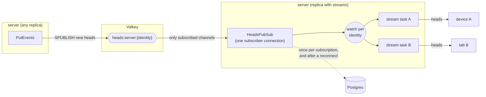
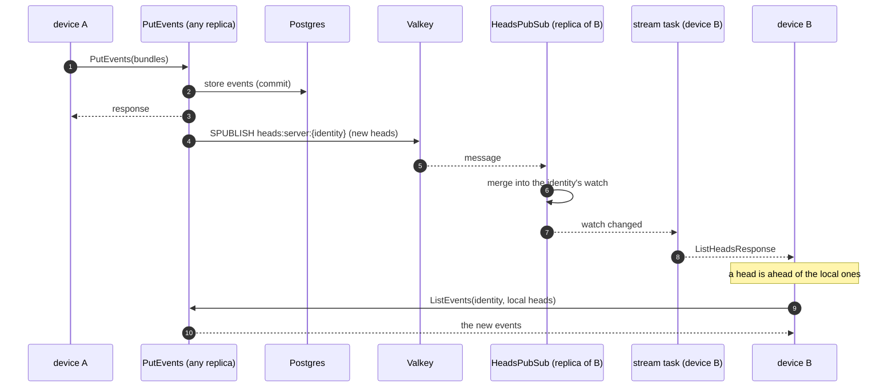

# Live Sync

When an identity publishes from one device or browser tab, its other devices
and tabs pull the new events within moments instead of at their next start.
Each client holds a gRPC stream open to its servers that reports the
identity's heads, and pulls whenever a server has a head it doesn't. This page
describes how a new event reaches those streams, why that path goes through
Valkey, and how it is built to keep up with hundreds of thousands of events
per second.

## Concepts

- **Head.** The highest sequence an identity has in one event stream, a
  `(collection, signer)` pair. `ListHeads` returns them, and partial pulls
  send them so a server returns only what comes after.
- **Heads stream.** `EventSyncService.SubscribeHeads` sends the authenticated
  identity's heads when it opens, then the latest heads whenever the server
  stores a new event for that identity.
- **Heads channel.** A Valkey sharded pub/sub channel per identity,
  `heads:{server name}:{identity}`, with literal braces around the identity.
  The braces are a cluster hash tag, so everything keyed by an identity lands
  on the same shard, and the `heads:` prefix keeps the channels easy to list
  (`PUBSUB SHARDCHANNELS heads:*`) and to scope in ACLs. `PutEvents`
  publishes to it, and only the
  server processes with a stream open for that identity subscribe to it.

| RPC              | Kind             | Served by |
| ---------------- | ---------------- | --------- |
| `SubscribeHeads` | server streaming | server    |

It takes the identity from the bearer token, see
[Server Authentication](../protocol/server-auth.md). A server without
`HARBOR_VALKEY_URL` answers `UNIMPLEMENTED`, and clients leave that server
alone instead of retrying it.

## Why Valkey

The obvious transports don't hold up at the target rate:

- **Postgres `NOTIFY`**, which [unread notifications](unread-notifications.md)
  use, serializes the commits that send it behind one global lock, and every
  listening process receives every notification. Fine for notification
  counts, a bottleneck for every stored event.
- **Kafka** already carries every event, but a consumer can't fetch only the
  messages it cares about. Every server process would read the whole stream,
  so broker traffic grows with the event rate times the number of server
  processes, whether or not they have subscribers.

Valkey sharded pub/sub delivers a message only to the connections subscribed
to its channel. A server process subscribes only to the identities that have
a stream open on it, so its traffic follows its own subscribers, not the
total event rate. Messages are fire and forget, which suits a signal the
client can always recover from by reconnecting: a missed message costs
latency, never events.

## Processes and connections

Each `server serve` process holds two Valkey connections for the life of the
process, one to publish and one to subscribe, whatever the number of streams.
`server workers` doesn't use Valkey.

**The registry.** `HeadsPubSub` keeps a `tokio::sync::watch` channel per identity
that has at least one stream on the process. Several devices or tabs of one
identity connected to the same process share it. The first stream for an
identity subscribes to its channel, and the channel is released once the last
stream for that identity closes. Subscribing and releasing are serialized per
identity, so a stream closing can't drop a channel another stream just
started using.

**Coalescing.** A `watch` channel holds only the latest value. A client that
reads slower than heads change, for instance during an import of thousands of
events, receives the newest heads and skips the ones in between.

**Database use.**

| Moment                         | Postgres                                       |
| ------------------------------ | ---------------------------------------------- |
| Stream opens                   | one `ListHeads` query on the primary           |
| Event stored                   | none (the heads travel in the message)         |
| Valkey reconnect or lag        | one `ListHeads` per identity followed on the process, 16 at a time |
| Idle                           | none                                           |

## A new event

`PutEvents` publishes once per identity per request, after the batch is
stored, with the highest new key per `(collection, signer)`. It publishes
from a spawned task, so a slow or unreachable Valkey never delays the
response. Duplicates aren't published.

The receiving process merges the keys into the identity's heads, keeping the
higher sequence per stream, so messages can arrive in any order and more than
once.

**Opening a stream** subscribes to the channel first and reads the heads from
the database second. Anything stored in between arrives as a message and
merges into the same heads, so nothing falls in the gap.

## Failures

- **Valkey restarts or the connection drops.** The client reconnects with
  backoff, resubscribes to every channel the process follows, then re-reads
  those identities' heads from the database, since messages sent while
  disconnected are lost.
- **The subscriber falls behind.** Messages for the whole process pass through one
  buffer of 4096. If it overflows, the process re-reads the heads of every
  identity it follows, as after a reconnect.
- **Valkey is down at startup.** The server starts anyway and keeps trying to
  connect. Until it connects, `SubscribeHeads` answers `UNAVAILABLE` and
  `PutEvents` skips publishing.
- **A server deploy or crash** ends the streams on that process. Clients
  reopen them on another replica, and the heads sent on open repair anything
  missed meanwhile.

## Client

`rs-core` exposes the stream as `Query.SubscribeHeads`. Like
`SubscribeUnreadNotificationCount`, it is built on `QueryClient::subscribe`:
one stream per configured server, re-opened when it ends. Reconnects wait
between 10 and 20 seconds, spread per client, so the clients of a restarted
server don't all return at once. The merged value is the highest head per
`(collection, signer)` across servers, since each server can miss events the
others have.

`PolycentricClient.startLiveSync()` in js-core subscribes for the active
identity and follows identity switches. On every value it compares the heads
with the local store and, when a server is ahead, runs
`sync(SyncStrategy.PARTIAL_PULL)`. Pulls run one at a time, and heads that
arrive during a pull cause a single follow-up pull. The device that wrote the
event sees its own heads come back and pulls nothing. Harbor starts live sync
in `PolycentricProvider`, and the existing `pulled` event refreshes its
stores.

## Scaling

With `N` events per second and `R` server replicas:

- **Writes.** One `SPUBLISH` per identity per `PutEvents` request, of a few
  hundred bytes. No Postgres work.
- **Valkey.** Delivers each message only to the replicas with a stream open
  for that identity, so outgoing traffic is about `N` times the number of
  replicas following the identity, independent of `R`. A single Valkey node
  handles a few hundred thousand small publishes per second. Beyond that, run
  Valkey in cluster mode: sharded pub/sub spreads channels across shards by
  hash slot, and the server's client routes each channel to its shard.
- **Server replicas.** Each holds two Valkey connections and one `watch` per
  followed identity, and does a hash lookup per message it receives.
- **Load balancer.** Streams are long-lived HTTP/2 requests. Allow long or no
  idle timeouts with keepalives, and don't buffer or compress responses
  (gRPC-web carries the stream as a chunked response). See
  [unread notifications](unread-notifications.md#client-fan-out) for what
  compression does to a stream.

## Configuration

| Variable            | Default   | Description |
| ------------------- | --------- | ----------- |
| `HARBOR_VALKEY_URL` | _(unset)_ | Valkey or Redis URL. `redis://host:6379` for a single node, `rediss://` for TLS, `redis-cluster://host:6379?node=host2:6379` for a cluster. Unset turns live sync off. |

Valkey 7 or newer is required (sharded pub/sub). It holds no data, so it
needs no persistence or backups. The dev stack in `compose.yml` runs one.

## Where the code is

| Piece                         | Path                                                               |
| ----------------------------- | ------------------------------------------------------------------ |
| Proto                         | `protos/polycentric/v2/events.proto`                               |
| Heads pub/sub (Valkey, registry) | `services/server/src/service/events/heads_pubsub.rs`            |
| Stream handler                | `services/server/src/service/events/rpc/subscribe_heads.rs`        |
| Publish                       | `services/server/src/service/events/rpc/put_events.rs`             |
| Integration tests             | `services/server/tests/src/heads.rs`                               |
| Client subscription           | `packages/rs-core/src/query/heads.rs`                              |
| Pull on new heads             | `packages/js-core/src/polycentric-client.ts` (`startLiveSync`)     |
| Harbor                        | `apps/harbor/src/common/lib/polycentric-hooks/PolycentricProvider.tsx` |
