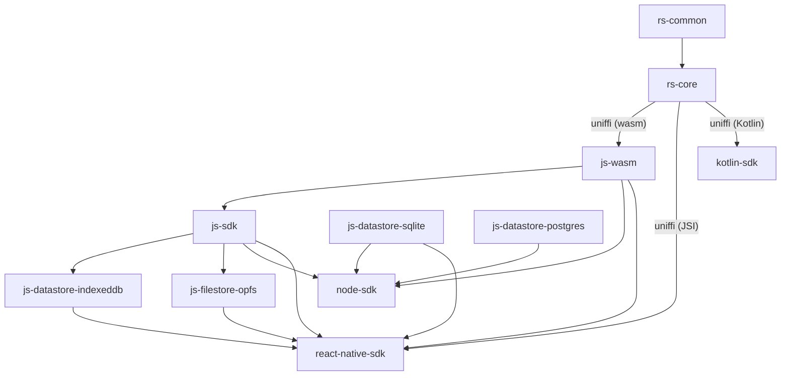

---

title: Project Structure
sidebar_label: Project Structure
sidebar_position: 2
---

# Project Structure

The [repository](https://code.futo.org/harbor/harbor) is a pnpm +
Cargo monorepo. Builds are orchestrated by [Turbo](https://turborepo.com), so
each package declares its own `build`, `test`, and `lint` tasks and the root
scripts fan out across them.

## Top level

| Path        | Contents                                                                                                                              |
| ----------- | ------------------------------------------------------------------------------------------------------------------------------------- |
| `apps/`     | End-user applications.                                                                                                                |
| `packages/` | Libraries and SDKs — the protocol core and its language bindings.                                                                     |
| `services/` | Server-side processes.                                                                                                                |
| `protos/`   | Protobuf definitions for the [Polycentric Protocol](../protocol/overview.md). The Rust and TypeScript types are generated from these. |
| `docs/`     | This documentation site (Docusaurus).                                                                                                 |
| `dev/`      | Developer tooling for testing                                                                                                         |

## Apps

| App           | Description                                                                   |
| ------------- | ----------------------------------------------------------------------------- |
| `apps/harbor` | The Harbor client — one Expo/React Native codebase for web, Android, and iOS. |

## Packages

The packages layer around a Rust core, called `rs-core`. It does the protocol work
(event assembly and validation, the query engine, sync, and gRPC transport), and is
exposed through [uniffi](https://mozilla.github.io/uniffi-rs/) as
`PolycentricCore`. The client libraries, `js-sdk` and its Kotlin port
`kotlin-sdk`, own identities, keys, logins, and persistence, and hand protocol work to
that core. The SDK packages build a client for one platform by supplying a
core, a storage driver, and a blob store.

Arrows point from a dependency to its dependants.

| Package                                      | Description                                                                                                                       |
| -------------------------------------------- | --------------------------------------------------------------------------------------------------------------------------------- |
| `packages/rust/rs-core`                      | The Rust protocol core: event signing and validation, queries, sync, and the local store. Everything else is a binding over this. |
| `packages/rust/rs-common`                    | Shared Rust code — protocol models and the generated protobuf types — used by `rs-core` and the services.                         |
| `packages/js/drivers/js-wasm`                | `uniffi-bindgen-react-native` bindings for `rs-core`: the shared TypeScript API plus a WASM build for web and Node.               |
| `packages/js/react-native-sdk`               | React Native SDK. The JSI TurboModule that wraps `rs-core` natively, over `js-wasm` on web, plus the Expo storage drivers.        |
| `packages/js/js-sdk`                         | Core JavaScript library holding the protocol logic and generated protobuf types.                                                  |
| `packages/js/drivers/js-datastore-indexeddb` | Browser storage driver, backed by IndexedDB.                                                                                      |
| `packages/js/drivers/js-filestore-opfs`      | Browser blob store, backed by the Origin Private File System (OPFS).                                                              |
| `packages/js/node-sdk`                       | Node.js SDK, storing data in sqlite3.                                                                                             |
| `packages/js/drivers/js-datastore-sqlite`    | Shared SQLite storage layer (Drizzle ORM) behind the JS SDKs.                                                                     |
| `packages/js/drivers/js-datastore-postgres`  | PostgreSQL storage layer, used by the Node.js SDK.                                                                                |
| `packages/kotlin/kotlin-sdk`                 | Core library holding the protocol logic and generated protobuf types, for Android development. This is a Kotlin port of `js-sdk`. |

## Services

| Service                       | Description                                                                                                                                                         |
| ----------------------------- | ------------------------------------------------------------------------------------------------------------------------------------------------------------------- |
| `services/server`             | The Polycentric server: ingests events, serves feeds, search, and blobs. See [Running a Server](../guides/running-a-server.md).                                     |
| `services/moderation`         | Labels content pushed to FUTO-run servers and publishes a labelling feed other servers can poll.                                                                    |
| `services/push-notifications` | Consumes the server's `notifications` Kafka topic, delivers Expo push notifications, and serves the gRPC `NotificationService` clients register device tokens with. |
| `services/grayjay-migrator`   | Re-signs legacy (v1) Grayjay systems as Harbor identities and serves the legacy key to identity lookup.                                                             |
| `services/scraper`            | Fetches link metadata for link previews.                                                                                                                            |
| `services/verifier-bot`       | Verifies platform claims. See [Verifiers](../protocol/verifiers.md).                                                                                                |
| `services/common`             | Shared Rust crates for the services — `dotenv`, `kafka`, `object-store`, and `telemetry`.                                                                           |

## Generated code

Two kinds of generated artifacts are worth knowing about, because stale copies
cause confusing build failures:

- **Protobuf types** are generated from `protos/` at build time (`prost` and
  `tonic` for Rust, `protobuf-ts` for TypeScript).
- **uniffi bindings** expose `rs-core` to TypeScript. None are committed. The
  React Native bindings are generated into `packages/js/react-native-sdk`
  (`src/generated/rn/`, `cpp/`, `ios/`, the `android/` module sources and
  `ReactNativeSdk.podspec`; see the `.gitignore`) by `pnpm generate`, which
  `pnpm build` also runs. The wasm bindings are built into
  `packages/js/drivers/js-wasm/src/generated/wasm/`. In CI the wasm job generates
  the React Native ones and passes them on with the wasm build. To regenerate
  them from scratch, run `pnpm ubrn:clean && pnpm generate`; see
  [Clearing stale build caches](./setup.md#clearing-stale-build-caches).
