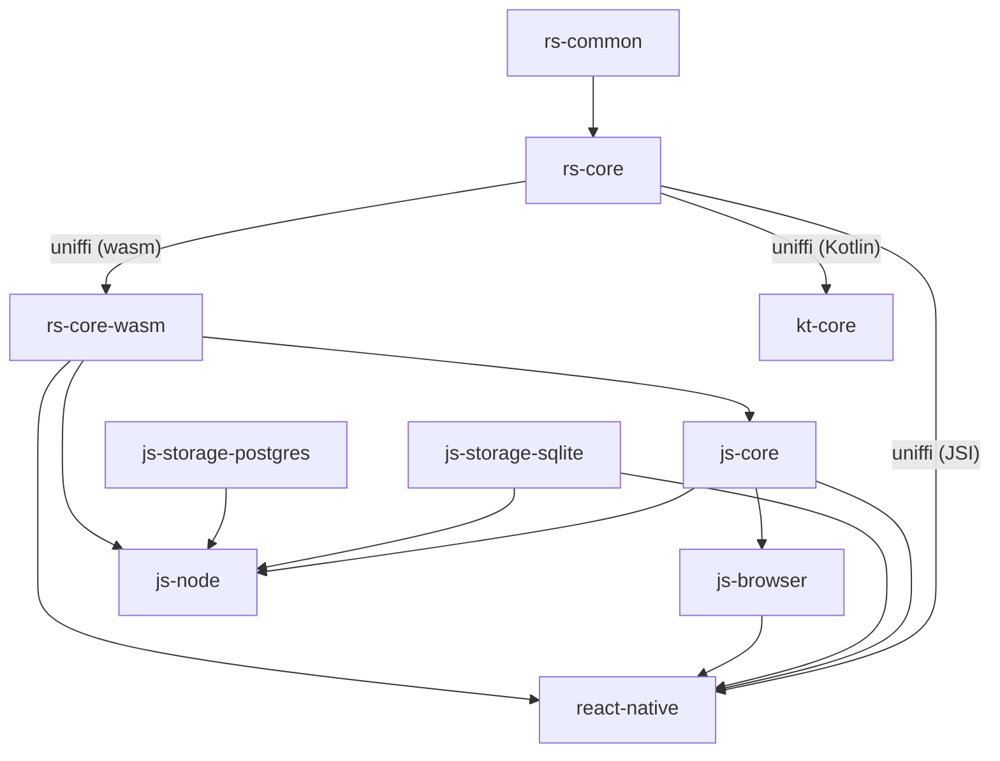

---

title: Project Structure
sidebar_label: Project Structure
sidebar_position: 2
---

# Project Structure

The [repository](https://code.futo.org/harbor/harbor) is a pnpm +
Cargo monorepo. Builds are orchestrated by [Turbo](https://turborepo.com), so
each package declares its own `build`, `test`, and `lint` tasks and the root
scripts fan out across them.

## Top level

| Path        | Contents                                                                                                                              |
| ----------- | ------------------------------------------------------------------------------------------------------------------------------------- |
| `apps/`     | End-user applications.                                                                                                                |
| `packages/` | Libraries and SDKs — the protocol core and its language bindings.                                                                     |
| `services/` | Server-side processes.                                                                                                                |
| `protos/`   | Protobuf definitions for the [Polycentric Protocol](../protocol/overview.md). The Rust and TypeScript types are generated from these. |
| `docs/`     | This documentation site (Docusaurus).                                                                                                 |
| `dev/`      | Developer tooling for testing                                                                                                         |

## Apps

| App           | Description                                                                   |
| ------------- | ----------------------------------------------------------------------------- |
| `apps/harbor` | The Harbor client — one Expo/React Native codebase for web, Android, and iOS. |

## Packages

The packages layer around a Rust core, called `rs-core`. It does the protocol work
(event assembly and validation, the query engine, sync, and gRPC transport), and is
exposed through [uniffi](https://mozilla.github.io/uniffi-rs/) as
`PolycentricCore`. The client libraries, `js-core` and its Kotlin port
`kt-core`, own identities, keys, logins, and persistence, and hand protocol work to
that core. The SDK packages build a client for one platform by supplying a
core, a storage driver, and a blob store.

Arrows point from a dependency to its dependants.

| Package                        | Description                                                                                                                                                                       |
| ------------------------------ | --------------------------------------------------------------------------------------------------------------------------------------------------------------------------------- |
| `packages/rs-common`           | Shared Rust code: protocol models, the generated protobuf types, validation, Merkle trees, signing, and JWTs. Used by `rs-core` and the services.                                 |
| `packages/rs-core`             | The Rust protocol engine: event assembly and validation, vector clocks, the query engine, sync, gRPC transport, and in-memory stores. Everything else is a binding over this.     |
| `packages/rs-core-wasm`        | Typescript bindings for `rs-core` using a WASM build of `rs-core` and `uniffi-bindgen-react-native`.                                                                              |
| `packages/js-core`             | Consumer-facing TypeScript client that wraps around `rs-core-wasm`, which accepts a storage and file-store implementation.                                                        |
| `packages/js-storage-sqlite`   | SQLite storage implementation which can be passed into `js-core`'s client.                                                                                                        |
| `packages/js-storage-postgres` | PostgreSQL storage implementation which can be passed into `js-core`'s client.                                                                                                    |
| `packages/js-browser`          | IndexedDB (for events and logins) and OPFS (for blobs) storage implementations which can be passed into `js-core`s client.                                                        |
| `packages/js-node`             | Complete Node.js SDK which builds a client using `js-core`, Node's file system access, and either storage implementation from `js-storage-sqlite` or `js-storage-postgres`        |
| `packages/react-native`        | React Native SDK. On iOS and Android, a JSI TurboModule wraps `rs-core` natively, with expo-sqlite and expo-file-system storage. On web, it uses `rs-core-wasm` and `js-browser`. |
| `packages/kt-core`             | Kotlin/Android SDK: a port of `js-core` over UniFFI's Kotlin bindings for `rs-core`, with its own SQLite storage.                                                                 |

## Services

| Service                       | Description                                                                                                                                                         |
| ----------------------------- | ------------------------------------------------------------------------------------------------------------------------------------------------------------------- |
| `services/server`             | The Polycentric server: ingests events, serves feeds, search, and blobs. See [Running a Server](../guides/running-a-server.md).                                     |
| `services/moderation`         | Labels content pushed to FUTO-run servers and publishes a labelling feed other servers can poll.                                                                    |
| `services/push-notifications` | Consumes the server's `notifications` Kafka topic, delivers Expo push notifications, and serves the gRPC `NotificationService` clients register device tokens with. |
| `services/grayjay-migrator`   | Re-signs legacy (v1) Grayjay systems as Harbor identities and serves the legacy key to identity lookup.                                                             |
| `services/scraper`            | Fetches link metadata for link previews.                                                                                                                            |
| `services/verifier-bot`       | Verifies platform claims. See [Verifiers](../protocol/verifiers.md).                                                                                                |
| `services/common`             | Shared Rust crates for the services — `dotenv`, `kafka`, `object-store`, and `telemetry`.                                                                           |

## Generated code

Two kinds of generated artifacts are worth knowing about, because stale copies
cause confusing build failures:

- **Protobuf types** are generated from `protos/` at build time (`prost` and
  `tonic` for Rust, `protobuf-ts` for TypeScript).
- **uniffi bindings** expose `rs-core` to TypeScript. None are committed. The
  React Native bindings are generated into `packages/react-native`
  (`src/generated/rn/`, `cpp/`, `ios/`, the `android/` module sources and
  `ReactNative.podspec`; see the `.gitignore`) by `pnpm generate`, which
  `pnpm build` also runs. The wasm bindings are built into
  `packages/rs-core-wasm/src/generated/wasm/`. In CI the wasm job generates
  the React Native ones and passes them on with the wasm build. To regenerate
  them from scratch, run `pnpm ubrn:clean && pnpm generate`; see
  [Clearing stale build caches](./setup.md#clearing-stale-build-caches).
