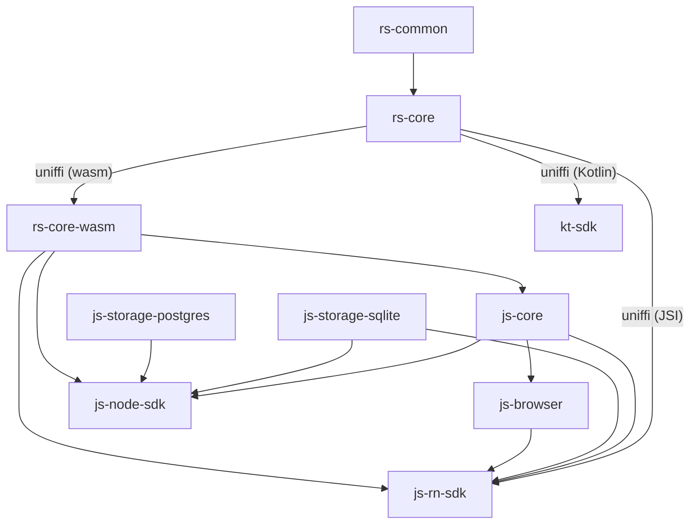

# Packages

Libraries and SDKs for the Polycentric protocol. One Rust engine does the
protocol work; every other package is either a binding over it, or an
interface that provides platform-specific storage primitives for those
bindings.

Arrows point from a dependency to its dependants. Outside `packages/`,
`apps/harbor` uses `js-rn-sdk`, `services/verifier-bot` uses `js-node-sdk`,
Android apps use `kt-sdk`, and the Rust services use `rs-common` or `rs-core`.

Each package's README covers its internals. The
[Project Structure](../docs/content/developer/project-structure.md) page
summarizes the function of each package.

## How a client is put together

`js-core` provides `PolycentricClient.create()`, which takes:

1. **`core`**: a `PolycentricCore` type from the UniFFI bindings generated around `rs-core`.
    - Web and Node use a wrapper around a WASM build at `rs-core-wasm`.
    - React Native uses a wrapper around a JSI build at `js-rn-sdk`.
    - Kotlin directly uses the UniFFI-generated Kotlin bindings of `rs-core`.
2. **`storageDriver`**: a database for persisting events and login/identity state.
    - React Native uses SQLite through `js-storage-sqlite`
    - Web uses IndexedDB from `js-browser`
    - Node uses either SQLite or Postgres through `js-storage-sqlite` or `js-storage-postgres`
    - Kotlin uses SQLite included in `kt-sdk`.
3. **`filestoreDriver`**: stores content blobs.
    - Web uses OPFS in `js-browser`.
    - Node uses the file system provided by `js-node-sdk`.
    - React Native uses the file system provided by `js-rn-sdk`.
    - Kotlin uses the file system provided by `kt-sdk`.

## Generated code

- Protobuf types are generated from `protos/`: `prost`/`tonic` in `rs-common`,
  `protobuf-ts` in `js-core`, and Wire in `kt-sdk`.
- uniffi bindings for `rs-core` are generated at build time and not
  committed: into `rs-core-wasm/src/generated/` and into `js-rn-sdk`
  (`pnpm generate`). `kt-sdk`'s Gradle build generates its own.
